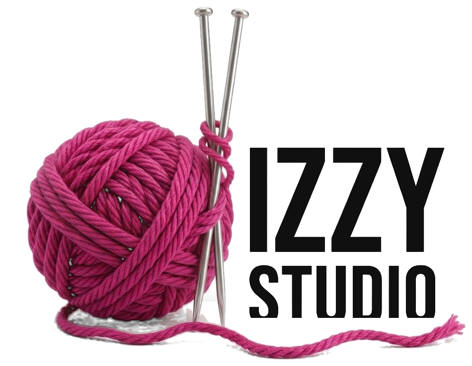

<div align="center">

<picture>
  <source media="(prefers-color-scheme: dark)" srcset="img/logo/dizzy-studio-logo-blanco.png">
  
</picture>

### Chunky knitwear in colours you can spot from across the street.

The online store for **Dizzy Studio**, a clothing brand of chunky-knit sweaters, cardigans and accessories.<br>
Hand-built in plain HTML, CSS and JavaScript: no frameworks, no libraries, no build step.

<br>


</div>

<br>

> [!IMPORTANT]
> **© 2026 Marco · Dizzy Studio. All rights reserved.**
> This repository is public for viewing only. It is **not** open source: the code, design, images
> and brand may not be copied, reused or deployed without written permission. See [LICENSE](LICENSE).

---

## 🧶 About the project

Dizzy Studio is a fashion brand built around bold, chunky knitwear. This repository is its online
store: a single page where visitors can browse the collection, open each garment's product page,
save favourites and fill a shopping bag.

The whole site is written by hand without any framework or external dependency, so it runs
straight from the file system with a double click on `index.html`.

## ✨ Features

- **Product catalogue** with category filters, bestsellers and new arrivals.
- **Product pages** with model photos, colour variants and sizes.
- **Bag and favourites** that are kept in the browser between visits.
- **Three languages**: English, Spanish and Simplified Chinese, switched instantly.
- **Light and dark mode**.
- **Animated yarn intro**: the page opens covered in magenta yarn that unravels to reveal the logo.
- **Responsive** down to 390 px wide, and every animation respects `prefers-reduced-motion`.

## 🚀 Run it locally

Double-click `index.html`, or serve the folder like a real site:

```bash
python3 -m http.server 8000
# then open http://localhost:8000
```

## 🔧 Built with

| | |
| --- | --- |
| **Stack** | Plain HTML, CSS and JavaScript. No frameworks, no npm, no CDNs. |
| **Translations** | Every visible string lives in `js/i18n.js`. |
| **Theming** | CSS custom properties for the light and dark palettes. |
| **Images** | `.webp` files with a smaller copy for each one, chosen by the browser with `srcset`. |
| **Fonts** | Self-hosted Anton, Albert Sans and IBM Plex Mono. |

All model and product photos are **AI-generated** (Google Gemini) and are placeholders until real
photography is available. The checkout is a demo: no payments are processed.

## © License

**Copyright © 2026 Marco · Dizzy Studio. All rights reserved.**

The code, design, texts, images and brand assets in this repository may not be copied, modified,
distributed or used, in whole or in part, without prior written permission. See [LICENSE](LICENSE).

The fonts in `fonts/` are third-party works under the SIL Open Font License 1.1. Their licences
are included next to each font file.
