<div align="center">

<picture>
  <source media="(prefers-color-scheme: dark)" srcset="img/logo/dizzy-studio-logo-blanco.png">
  
</picture>

### Chunky knitwear in colours you can spot from across the street.

An online store for the **Dizzy Studio** clothing brand, with a western capsule called **High Noon**.<br>
Hand-built in plain HTML, CSS and JavaScript: no frameworks, no libraries, no build step.

<br>


[Features](#-features) ·
[High Noon](#-high-noon--drop-02) ·
[Catalogue](#-the-catalogue) ·
[Run it](#-run-it-locally) ·
[Under the hood](#-under-the-hood) ·
[License](#-license)

<br>

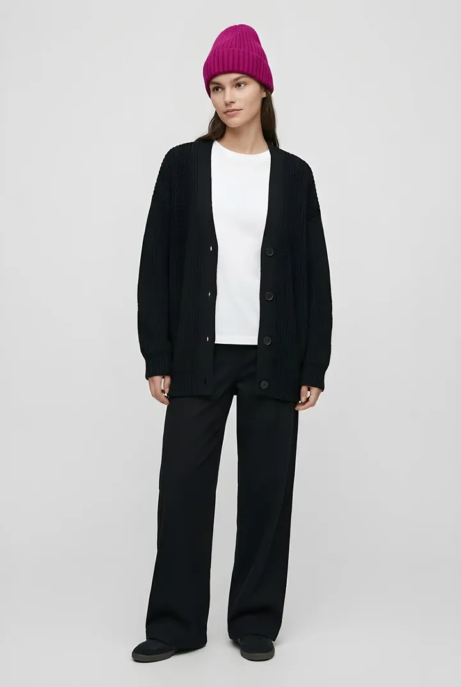
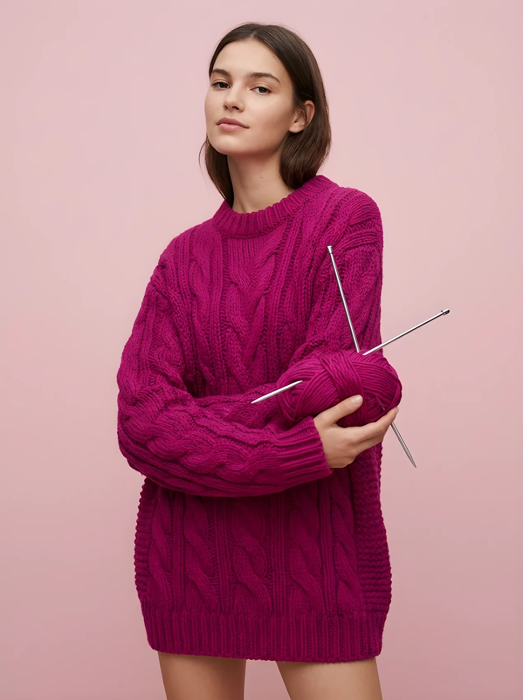
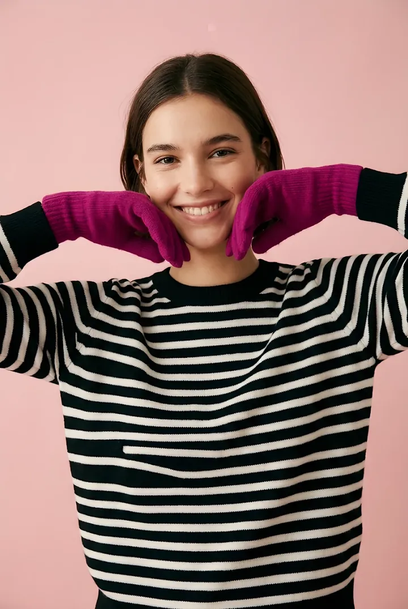

</div>

<br>

> [!IMPORTANT]
> **© 2026 Marco · Dizzy Studio. All rights reserved.**
> This repository is public for viewing only. It is **not** open source: the code, design, images
> and brand may not be copied, reused or deployed without written permission. See [LICENSE](LICENSE).

---

## ✨ Features

<table>
<tr>
<td width="50%" valign="top">

**🧶 Yarn intro**<br>
The page opens covered in magenta yarn. The threads unravel in two seconds, reveal
*DIZZY STUDIO*, roll it into a ball of yarn and fling it into the header logo.

</td>
<td width="50%" valign="top">

**⭐ Sheriff star intro**<br>
Entering High Noon, a brass sheriff star hanging from a nail takes five bullet holes,
drops off and falls out of frame.

</td>
</tr>
<tr>
<td valign="top">

**🛍️ Full shop flow**<br>
Category filters, bestsellers, new arrivals, product pages with four model poses,
colour variants, sizes, favourites and a bag that survives a page reload.

</td>
<td valign="top">

**🌍 Three languages**<br>
English, Spanish and Simplified Chinese, switched instantly and remembered for the next visit.

</td>
</tr>
<tr>
<td valign="top">

**🌗 Light and dark mode**<br>
Two complete palettes for the wool store and two more for the western theme.

</td>
<td valign="top">

**📱 Mobile-first**<br>
Works down to 390 px with no horizontal scroll. The lookbook scrolls sideways as you scroll down,
or swipes on touch screens.

</td>
</tr>
<tr>
<td valign="top">

**⏳ Drop countdown**<br>
A live countdown to the next drop on the home page.

</td>
<td valign="top">

**♿ Motion-aware**<br>
Every animation respects `prefers-reduced-motion`, and both intros can be skipped with a click or <kbd>Esc</kbd>.

</td>
</tr>
</table>

---

## 🤠 High Noon · Drop 02

<table>
<tr>
<td width="30%" align="center">

</td>
<td width="70%">

*Showdown in denim.* Five pieces, two belt colours and one rule: whoever draws first with their
fingers wins. Every piece is unisex and cut to be shared.

The capsule has its own page at `index.html#high-noon` with a full western theme: sand, leather,
stitch orange and denim blue, plus **Rye** headlines. A giant title opens as you scroll, the duel photo
expands to fill the screen, and hovering any product in the mosaic shows it being worn.

</td>
</tr>
</table>

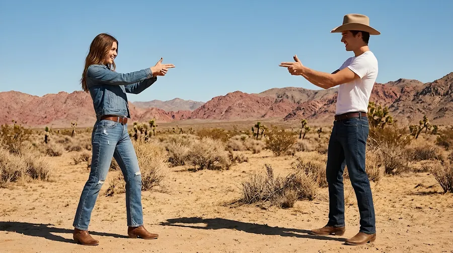

---

## 👕 The catalogue

<div align="center">

<table>
<tr>
<td align="center">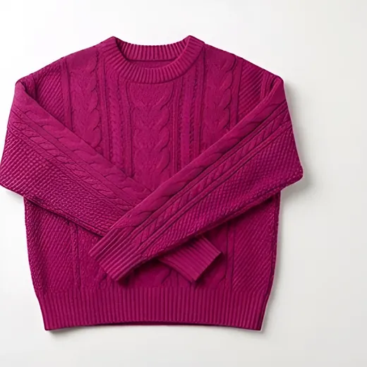<br><sub><b>Cable Sweater</b><br>€89</sub></td>
<td align="center">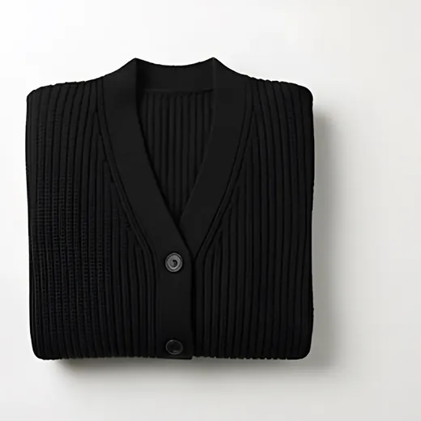<br><sub><b>Night Cardigan</b><br>€95</sub></td>
<td align="center">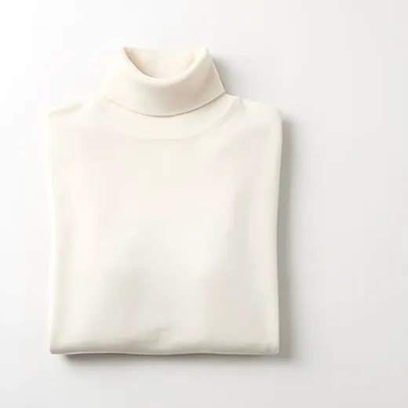<br><sub><b>Cloud Turtleneck</b><br>€79</sub></td>
<td align="center">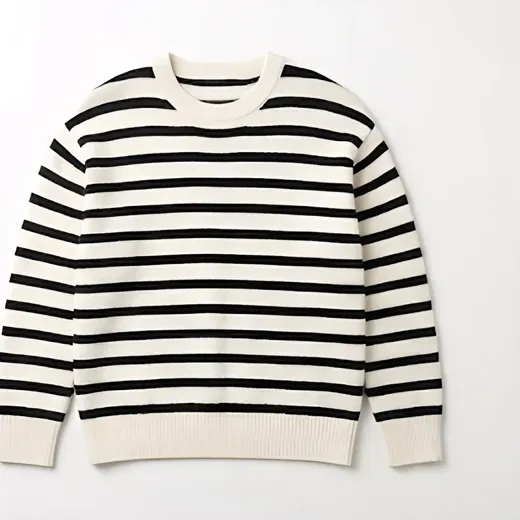<br><sub><b>Breton Sweater</b><br>€75</sub></td>
<td align="center">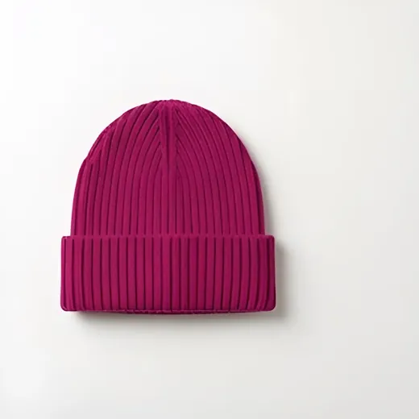<br><sub><b>Ribbed Beanie</b><br>€29</sub></td>
<td align="center">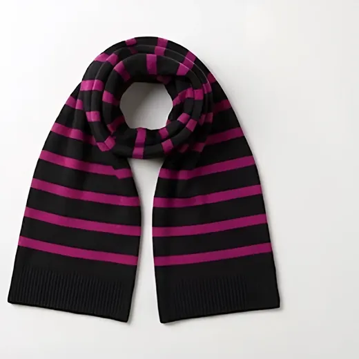<br><sub><b>Striped Scarf</b><br>€45</sub></td>
</tr>
<tr>
<td align="center">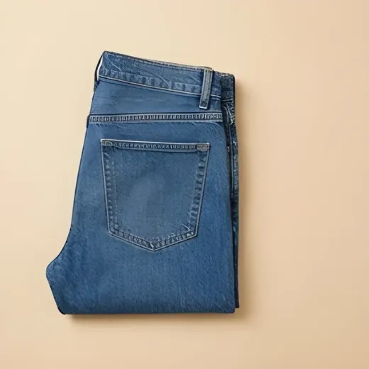<br><sub><b>Dust Jeans</b><br>€95</sub></td>
<td align="center"><br><sub><b>Sundown Hat</b><br>€69</sub></td>
<td align="center">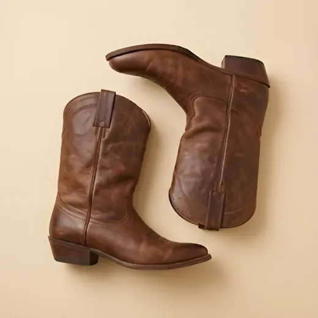<br><sub><b>Rattler Boots</b><br>€189</sub></td>
<td align="center">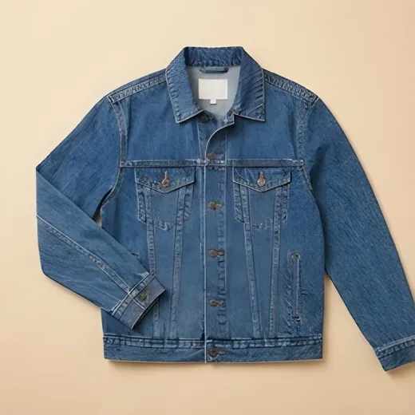<br><sub><b>Sheriff Denim Jacket</b><br>€119</sub></td>
<td align="center">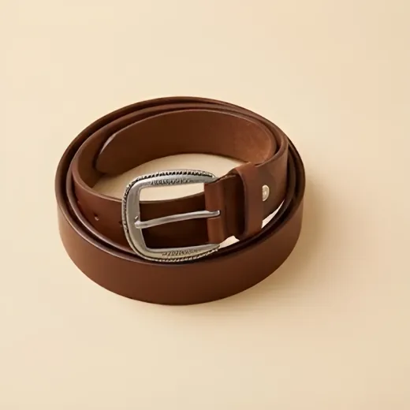<br><sub><b>Buckle Belt</b><br>brown</sub></td>
<td align="center">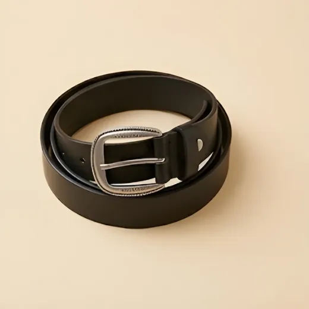<br><sub><b>Buckle Belt</b><br>black</sub></td>
</tr>
</table>

<sub>12 knitwear pieces and 5 High Noon pieces in total. Top row: wool store · Bottom row: High Noon.</sub>

</div>

---

## 🚀 Run it locally

No install, no build. Just open it:

```text
double-click index.html
```

Or serve it like a real site:

```bash
python3 -m http.server 8000
# then open http://localhost:8000
```

The *Live Server* extension for Visual Studio Code works too.

---

## 🔧 Under the hood

| | |
| --- | --- |
| **Stack** | Plain HTML, CSS and JavaScript. No frameworks, no npm, no CDNs: it works offline and straight from the file system. |
| **Routing** | One page, three views: the wool store (`#inicio`), High Noon (`#high-noon`) and product pages (`#<id>` or `#<id>-<colour>`). |
| **Catalogue** | A single `P` array in `js/main.js`. Images are found by naming convention, so adding a garment means adding one object and its photos. |
| **i18n** | Every visible string lives in `js/i18n.js` and is wired up with `data-i18n`, `data-i18n-html` and `data-i18n-attr`. |
| **Theming** | CSS custom properties on `:root`, `[data-look="dark"]` and `.theme-west`. |
| **Images** | Every image is `.webp`, with a smaller copy in `sm/` for `srcset` (520 / 640 / 720 / 900 px). |
| **Performance** | Scroll handlers read every measurement before writing any style, and the yarn intro only redraws the layer being removed. |
| **Fonts** | Self-hosted Anton, Albert Sans, IBM Plex Mono and Rye. Chinese falls back to system fonts. |
| **State** | The bag, favourites, language and theme are kept in `localStorage`. |

<details>
<summary><b>📁 Project structure</b></summary>

<br>

```text
dizzy-studio/
├── index.html          Single page: wool store, High Noon and product page
├── css/styles.css      Colour tokens, light/dark mode, western theme, animations
├── js/i18n.js          Every visible string in EN, ES and ZH
├── js/main.js          Catalogue, bag, favourites, routing, scroll and intros
├── fonts/              Self-hosted fonts and their licences
└── img/
    ├── logo/           Yarn ball, thread and full logos
    ├── productos/      Flat-lay photo of each garment
    ├── poses/          Four model photos per garment
    ├── lookbook/       Lookbook photos
    ├── west/           Duel photo and sheriff star frames
    ├── hero.webp       Cover photo
    └── taller.webp     Workshop photo
```

</details>

<details>
<summary><b>📝 Notes</b></summary>

<br>

- The **Checkout** button is a demo: no payments are processed.
- All model and product photos are **AI-generated** (Google Gemini) and are placeholders until
  real photography is available.
- The logo lettering is embedded in the stylesheet as an encoded image, so CSS masks also work
  when `index.html` is opened from the file system.

</details>

---

## © License

**Copyright © 2026 Marco · Dizzy Studio. All rights reserved.**

The code, design, texts, images and brand assets in this repository may not be copied, modified,
distributed or used, in whole or in part, without prior written permission. See [LICENSE](LICENSE).

The fonts in `fonts/` are third-party works under the SIL Open Font License 1.1. Their licences
are included next to each font file.

<div align="center">
<br>
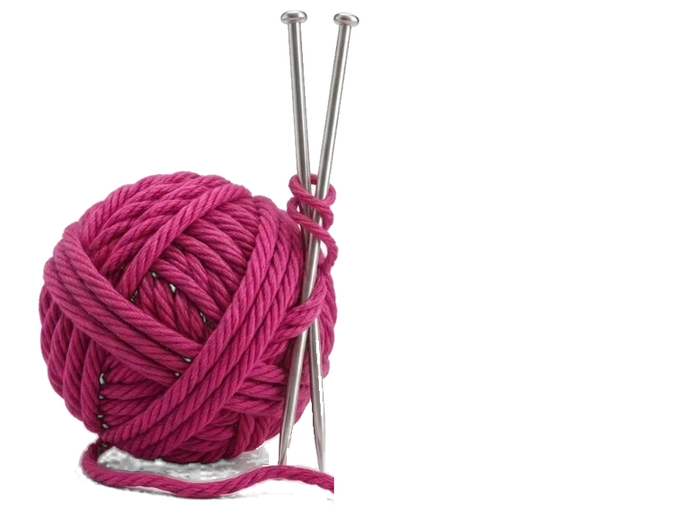
<br>
<sub>Made with yarn and plain JavaScript.</sub>
</div>
